<p align="center">
  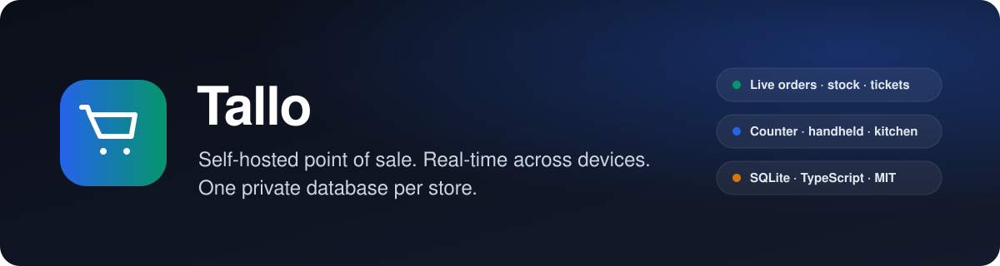
</p>

<p align="center">
  <a href="LICENSE"></a>
  
  
  
  
  
  
</p>

<p align="center">
  <a href="#overview">Overview</a> ·
  <a href="#features">Features</a> ·
  <a href="#product-tour">Product tour</a> ·
  <a href="#architecture">Architecture</a> ·
  <a href="#roles-and-permissions">Roles</a> ·
  <a href="#security-and-privacy">Security &amp; privacy</a> ·
  <a href="#getting-started">Getting started</a> ·
  <a href="SETUP.md">Setup guide</a>
</p>

---

## Overview

Tallo is a self-hosted point-of-sale system for shops, cafés, and restaurants. It runs as a single Node.js
process with a React front end and stores each business in its own SQLite database. Cashiers, handheld order-takers,
customer-facing displays, and kitchen screens all connect to the same store and stay in sync in real time.

It is designed for owners who want a fast register without a per-device subscription, and for teams who want to know
exactly where their sales data lives: in one file they can back up, export, or delete.

<p align="center">
  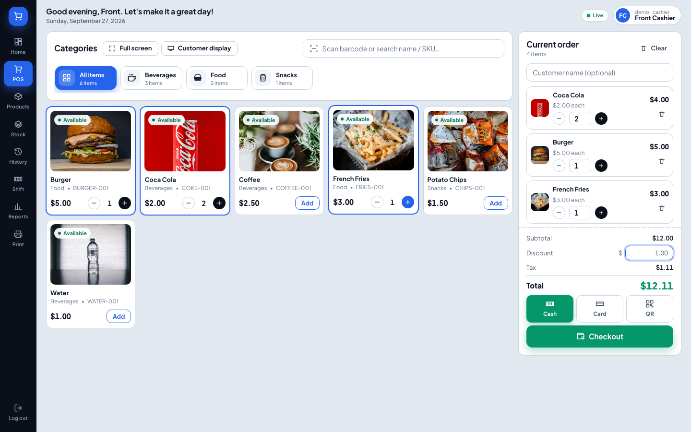
  <br /><sub>The register: photo catalogue, barcode search, running order, payment methods, and checkout.</sub>
</p>

## Features

| Area                  | What you get                                                                                                                                                                        |
| --------------------- | ----------------------------------------------------------------------------------------------------------------------------------------------------------------------------------- |
| **Point of sale**     | Barcode and name search, photo product cards, order-level discounts, per-product tax, cash / card / QR and split payments, change calculation, printable receipts, full-screen mode |
| **Customer display**  | A second window for a customer-facing screen showing the live order, totals, and change due                                                                                         |
| **Order devices**     | A Sales role for phones and tablets that can only place orders; unlimited devices per store                                                                                         |
| **Real time**         | Orders, stock levels, shift status, and print jobs pushed to every connected device over Server-Sent Events                                                                         |
| **Printing by area**  | One printer per station (counter, drink maker, kitchen 1, kitchen 2, …); a ticket per area with only that area's items; network ESC/POS or browser print stations                   |
| **Inventory**         | Every stock change is a recorded movement with a reason; no overselling; refunds return stock; low-stock alerts                                                                     |
| **Shifts**            | Opening float, cash in / out, expected versus counted cash, difference recorded per shift                                                                                           |
| **History & refunds** | Filterable sales history; item-level refunds; immutable completed sales; reprint receipts and tickets                                                                               |
| **Reports**           | Daily sales, payment summary, product performance, and inventory value for any date range                                                                                           |
| **Privacy**           | One private database per store, store-bound sign-in, self-serve store creation, one-click export, password-confirmed permanent deletion                                             |

## Product tour

<table>
  <tr>
    <td width="50%" valign="top">
      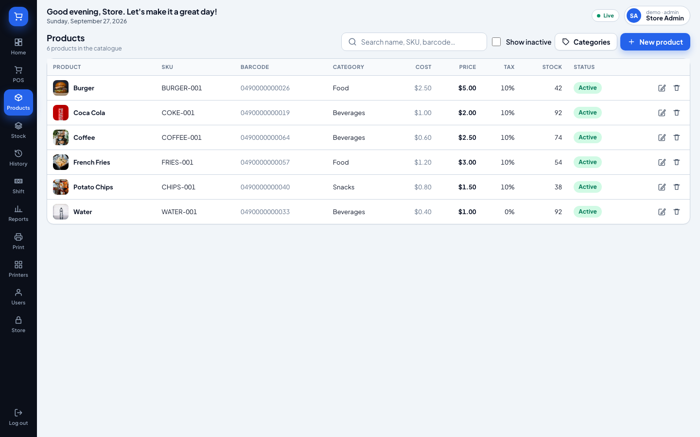
      <p><strong>Catalogue.</strong> Products with photos, SKUs, barcodes, cost and selling prices, tax rates, stock, and print area. Categories carry a default print area.</p>
    </td>
    <td width="50%" valign="top">
      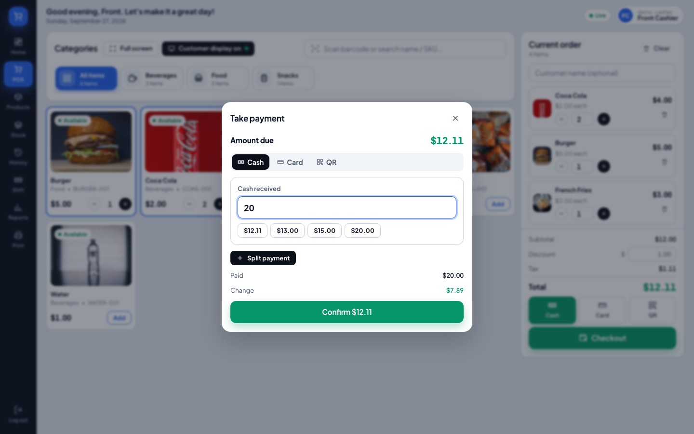
      <p><strong>Payment.</strong> Cash with quick-tender buttons and change, card and QR with an optional reference, or split across methods. Totals are computed on the server.</p>
    </td>
  </tr>
  <tr>
    <td width="50%" valign="top">
      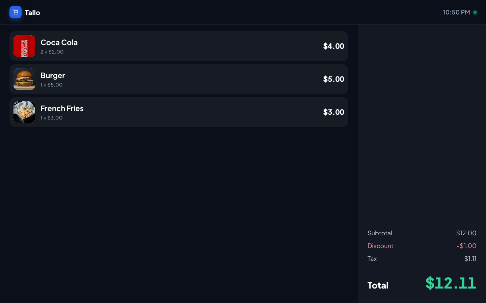
      <p><strong>Customer display.</strong> Opened from the register onto a second monitor. Shows the order as it is built, then the change due after payment.</p>
    </td>
    <td width="50%" valign="top">
      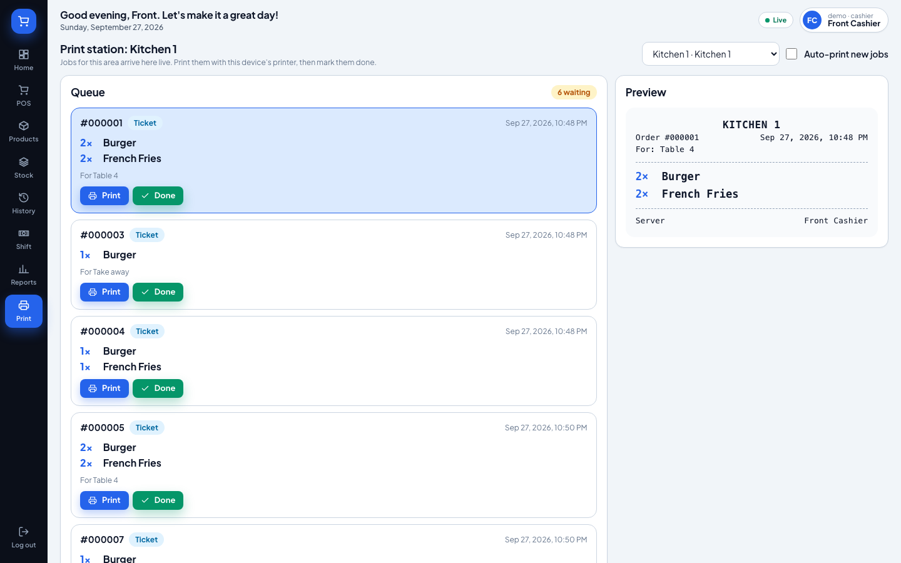
      <p><strong>Print station.</strong> A tablet in the kitchen picks its area and receives that area's tickets live. Print locally, mark done, reprint if needed.</p>
    </td>
  </tr>
  <tr>
    <td width="50%" valign="top">
      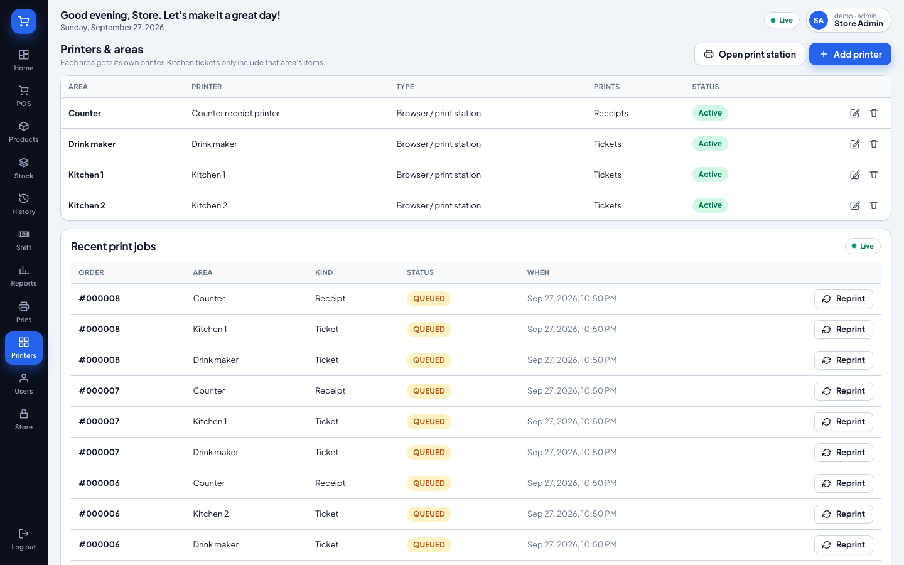
      <p><strong>Printers and areas.</strong> Add as many areas as the floor needs. Network printers get a connection test; failed jobs can be resent.</p>
    </td>
    <td width="50%" valign="top">
      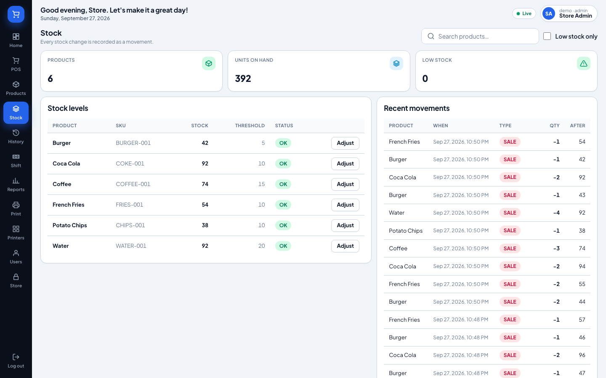
      <p><strong>Stock.</strong> Levels and thresholds next to the movement log. Purchases, sales, returns, damage, and adjustments are all traceable.</p>
    </td>
  </tr>
  <tr>
    <td width="50%" valign="top">
      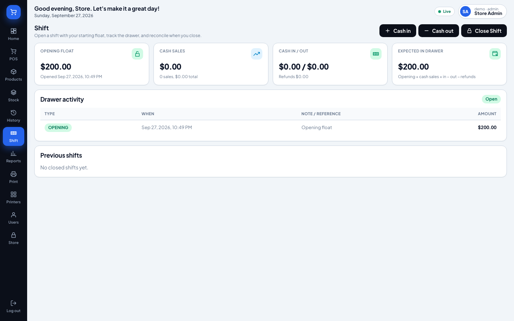
      <p><strong>Shifts.</strong> Open with a float, record cash in and out, close with a count. Expected cash comes from the shift's own transactions.</p>
    </td>
    <td width="50%" valign="top">
      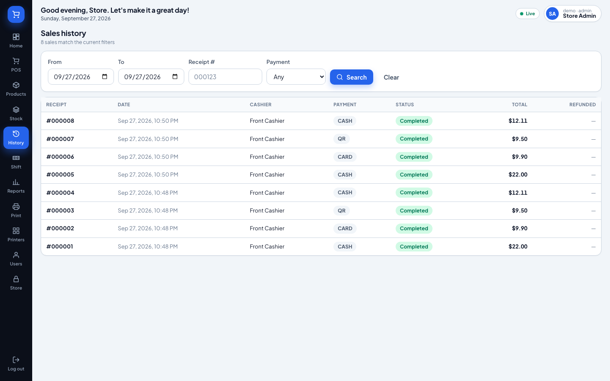
      <p><strong>History.</strong> Filter by date, receipt, cashier, or payment method. Open a sale to refund items or reprint.</p>
    </td>
  </tr>
  <tr>
    <td width="50%" valign="top">
      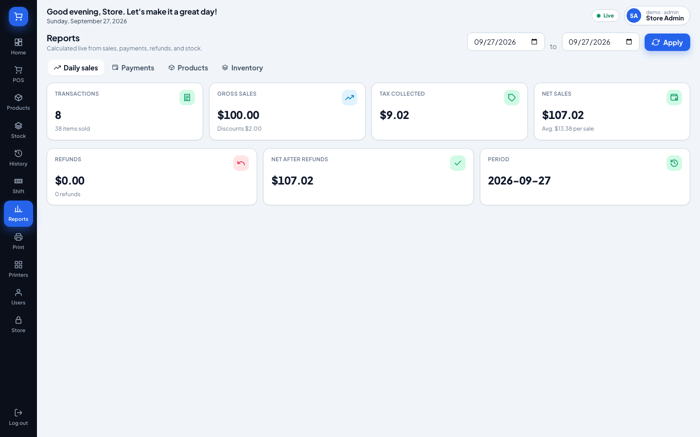
      <p><strong>Reports.</strong> Daily sales, payment breakdown, product performance, and inventory value, calculated from transactions rather than counters.</p>
    </td>
    <td width="50%" valign="top">
      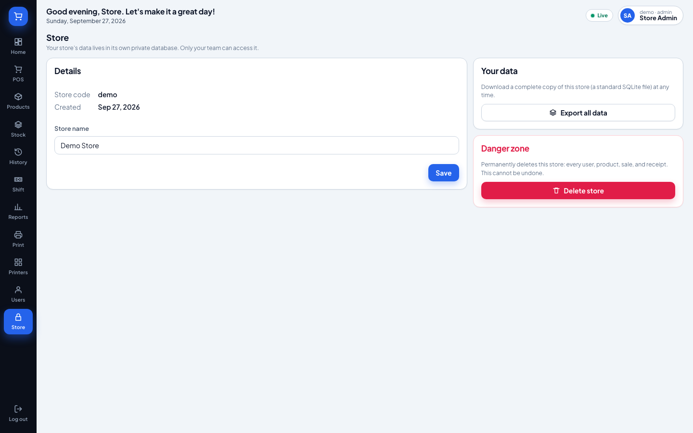
      <p><strong>Store.</strong> Rename the store, export the complete database, or delete it permanently after confirming your password.</p>
    </td>
  </tr>
</table>

<p align="center">
  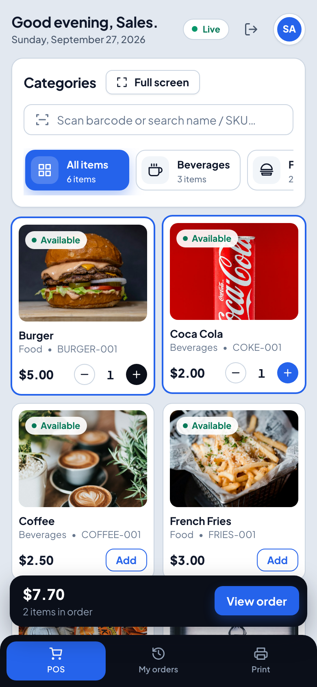
  &nbsp;&nbsp;
  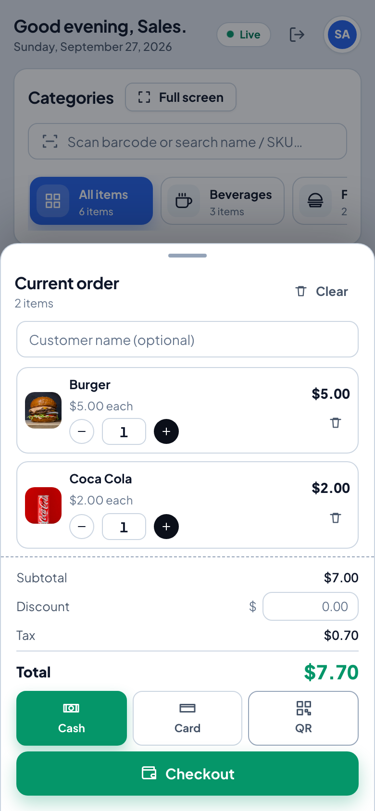
  <br /><sub>The same store on a phone: the Sales role takes orders on the floor while the counter keeps the drawer.</sub>
</p>

## Architecture

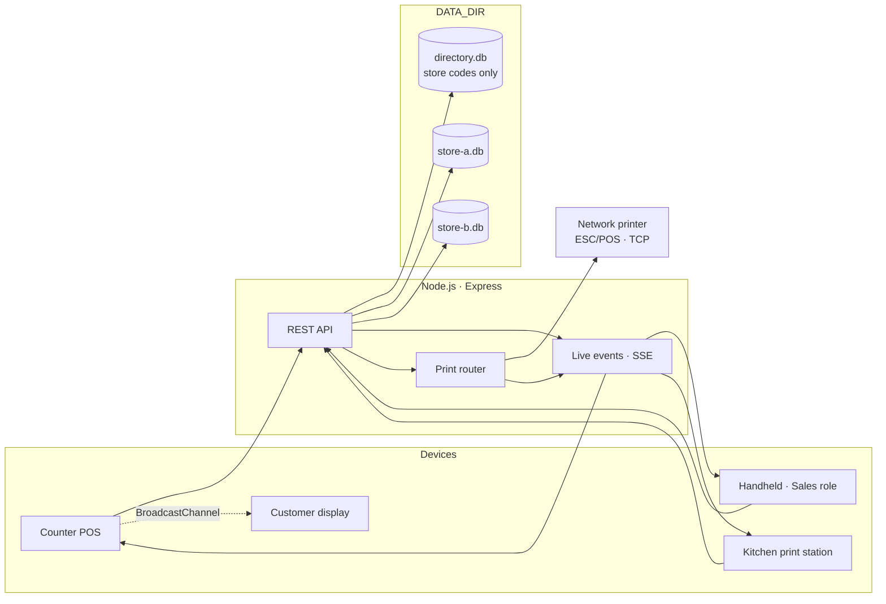

- **Three packages, one repository.** `shared/` contains the pure business logic (integer-cent money, cart totals, payment validation) used by both server and client. `server/` is an Express API. `client/` is a Vite + React application.
- **One database per store.** A request is bound to the store named in its token and can only reach that store's file. The directory database holds store codes and names, nothing else.
- **Transactional checkout.** Shift, product, and stock validation, server-side totals, sale and payment rows, stock deduction with movements, and cash booking happen in a single transaction; any failure rolls back everything.
- **Events after commit.** `sale.created`, `stock.changed`, `refund.created`, `register.changed`, and `print.job` are broadcast only once the transaction has committed, scoped to the store.
- **Printing never blocks a sale.** Jobs are created after commit; network jobs are sent over TCP and marked printed or failed, browser jobs wait for a print station.

## Roles and permissions

| Capability                         | Admin | Cashier | Sales |
| ---------------------------------- | :---: | :-----: | :---: |
| Browse catalogue with live stock   |  ✅   |   ✅    |  ✅   |
| Place orders                       |  ✅   |   ✅    |  ✅   |
| Print station                      |  ✅   |   ✅    |  ✅   |
| Sales history                      |  All  |   All   |  Own  |
| Refunds                            |  ✅   |   ✅    |   —   |
| Open / close shifts, cash in / out |  ✅   |   ✅    |   —   |
| Stock page and adjustments         |  ✅   |  View   |   —   |
| Products and categories            |  ✅   |  View   |   —   |
| Reports                            |  ✅   |   ✅    |   —   |
| Printers and routing               |  ✅   |    —    |   —   |
| Users and roles                    |  ✅   |    —    |   —   |
| Store export and deletion          |  ✅   |    —    |   —   |

Sales-role orders are booked against the store's open shift, so the cashier's drawer still reconciles.

## Security and privacy

| Concern            | How it is handled                                                                                    |
| ------------------ | ---------------------------------------------------------------------------------------------------- |
| Tenant isolation   | One SQLite file per store (`0600`); requests can only reach the store bound to their token           |
| Authentication     | JWT sessions, bcrypt password hashes, login rate limiting, immediate revocation on user deactivation |
| Authorisation      | Role checks on every route; the UI mirrors them but never replaces them                              |
| Input handling     | All external input validated with Zod; all SQL parameterised; server recomputes every total          |
| Logging            | Tokens redacted, request bodies never logged, no card data stored (optional reference number only)   |
| Auditing           | Stock adjustments, refunds, price changes, user and role changes, shift close, printer changes       |
| Data portability   | Admins download the store's complete SQLite file at any time                                         |
| Right to erasure   | Password-confirmed deletion removes the store's file immediately                                     |
| At-rest encryption | Not provided by the application; run on an encrypted volume (SQLCipher support is on the roadmap)    |

## Getting started

```bash
npm install
cp server/.env.example server/.env   # set JWT_SECRET
npm run db:seed                       # creates the seeded "demo" store
npm run dev                           # API on :3000, UI on :5173
```

Sign in at http://localhost:5173 with store code `demo`, username `admin`, password `test-password`, or choose
**Create your own private store** to start empty.

**Requirements:** Node.js 22.13 or newer. SQLite is built into Node, so there is no database server and no native
compilation.

Installation options, configuration, printer setup, the API reference, and development workflow are documented in
**[SETUP.md](SETUP.md)**.

## Technology

| Layer     | Choice                                 | Why                                                             |
| --------- | -------------------------------------- | --------------------------------------------------------------- |
| Front end | React 19, TypeScript, Vite             | Fast, keyboard- and scanner-friendly UI that runs on any device |
| API       | Node.js 22, Express 5, Zod, pino       | Small surface, strict validation, structured logs               |
| Data      | SQLite via `node:sqlite`               | Zero setup, one file per store, transactional, easy to back up  |
| Real time | Server-Sent Events, `BroadcastChannel` | No broker required for a single-server deployment               |
| Printing  | ESC/POS over TCP, browser print        | Works with common receipt printers or with no printer at all    |
| Tests     | Vitest, Supertest, Playwright          | Logic, API, and browser coverage of every critical workflow     |

## Quality

| Suite                       | Scope                                                                                                                           | Count |
| --------------------------- | ------------------------------------------------------------------------------------------------------------------------------- | ----: |
| Shared unit tests           | Money rounding, discount allocation, tax, cart state, payment validation                                                        |    81 |
| Server unit and integration | Auth, roles, products, inventory, checkout, refunds, shifts, reports, printing, stores                                          |   246 |
| End-to-end (Playwright)     | Login, catalogue, sale, inventory, refund, shift, Sales role, two-device real time, printing, private stores, full MVP scenario |    23 |

Coverage thresholds are enforced in CI: 90% for business logic, 80% for backend services, 75% overall.

## Roadmap

- [ ] Customer accounts, loyalty, and store credit
- [ ] Tables and open tabs for restaurants
- [ ] Purchase orders and supplier receipts
- [ ] CSV export and scheduled report emails
- [ ] Encrypted store files (SQLCipher)
- [ ] Offline-first POS with background sync
- [ ] Modifiers, combos, and weighed items
- [ ] Localisation and multi-currency formatting
- [ ] Multi-instance deployments via a shared event broker

## FAQ

**Do I need a receipt printer?** No. Any area can be served by a browser print station, and receipts print through the browser. Add network printers when you have them.

**Can one Sales login be used on several devices?** Yes. Sessions are stateless tokens. Create one account per device if you want to distinguish them in history.

**Where is my data?** In `server/data/stores/<store-code>.db`, a standard SQLite file. Back it up like any file or download it from the Store page.

**Can I disable public sign-up?** Yes: `ALLOW_SIGNUP=false`. Existing stores keep working and admins can still add users.

**Does it need internet access?** No. The devices need to reach the server on the local network; nothing calls out.

**Does it process card payments?** No. Card and QR payments are recorded with an optional reference from your terminal or provider.

## Contributing

Issues and pull requests are welcome. `npm run dev` starts the stack, `npm run test` runs the logic and API suites in a few seconds, `npm run test:e2e` runs the browser scenarios, and `npm run docs:screenshots` regenerates the images in this file. Please add tests for anything that touches money, stock, or permissions, and keep dependencies minimal.

## License

Released under the [MIT License](LICENSE).
